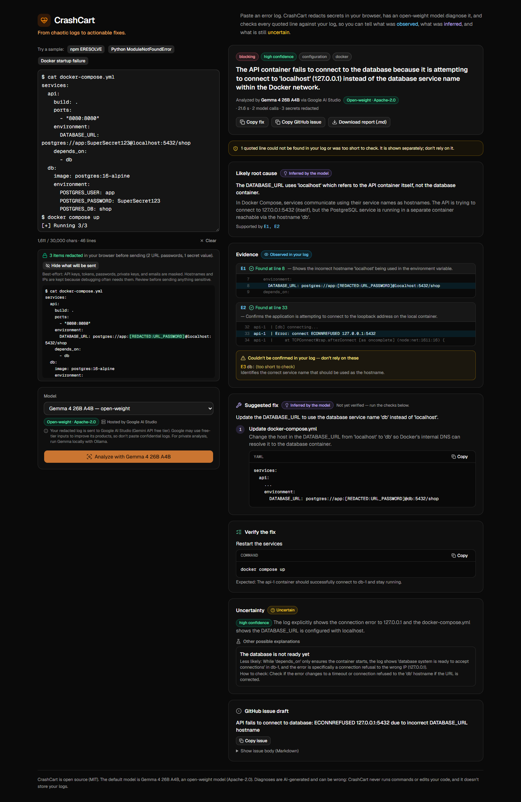

# CrashCart

> [!NOTE]
> **This project was made solely as an entry for the [DEV Hacktoberfest Open-Source AI Challenge, Week 2: Side Hustle](https://dev.to/challenges/hacktoberfest-week2-2026-10-12)** — nothing more than that. It is a time-boxed hackathon prototype, not a maintained product or a commercial service.

**From chaotic logs to actionable fixes.**

CrashCart is an evidence-backed debugging assistant for developers. Paste a terminal log, stack trace, or build failure. CrashCart redacts secrets in your browser, has **Gemma 4** (an open-weight model) diagnose it, and then **checks every line the model quotes against your actual log** before showing it to you.

Every diagnosis separates three kinds of claims:

| | What it means | How CrashCart enforces it |
|---|---|---|
| **Observed** | Exact lines from your log | Each quote is searched for in your input. Found quotes get real line numbers; quotes that can't be found are flagged ⚠ and shown separately. |
| **Inferred** | The model's root cause and suggested fix | Tied to the evidence ids that support it. Fixes are labelled "not yet verified" and come with verification steps. |
| **Uncertain** | Confidence, alternatives, unknowns | If none of the quotes can be found, CrashCart lowers confidence to *low* itself, and shows what the model originally claimed. |

> **Live demo:** _not deployed yet_ · **Demo video:** _not recorded yet_



## What you get

- A one-line summary, severity, category, and calibrated confidence.
- The likely root cause, with the evidence lines it rests on, highlighted in context.
- The smallest safe fix, with commands or config snippets and copy buttons.
- Verification steps with expected results.
- Alternative explanations and what the log doesn't show.
- Warnings for risky commands (`rm -rf`, `--force`, `--legacy-peer-deps`, `curl | sh`, `docker system prune`, …), detected by deterministic rules, not by the model.
- A ready-to-paste **GitHub issue** and a downloadable **Markdown report**.
- The provider and model that actually produced the result, with its license.

CrashCart never runs commands, never edits your code, and never stores your logs.

## How it works

```
Browser                                        Next.js server
───────                                        ──────────────
paste log → normalize (CRLF, ANSI)             POST /api/analyze
          → redact secrets (preview shown)  ─►   origin check · per-IP rate limit
          → choose model                         validate input · redact again
                                                 prompt: log as nonce-delimited, line-numbered DATA
                                                 adapter → Gemma 4 (Gemini API) / any OpenAI-compatible API
                                                 extract JSON → Zod validation → ≤1 repair or retry
                                                 verify every evidence quote against the log
                                                 adjust confidence · scan commands · build issue
render diagnosis (plain text only)  ◄────────    Diagnosis JSON + provenance
copy fix · copy issue · download .md
```

- **One app:** Next.js 16 (App Router), TypeScript, Tailwind CSS v4, shadcn/ui, Zod 4. No database, queue, or auth.
- **Provider adapters** share one interface. The UI never contains provider-specific code.
  - `@google/genai` for Gemma and Gemini on the Gemini API.
  - The `openai` SDK for any OpenAI-compatible endpoint: Ollama, xAI, vLLM, llama.cpp, or hosted inference providers.
- **Bounded calls:** at most two model replies per analysis (the original, plus one repair turn *or* one retry without optional parameters), plus up to two same-model retries after fast transient server errors. **Never an automatic switch to a different model.**

## Quick start

Requirements: Node.js 22.18 or newer, and a Google AI Studio API key (free).

```bash
npm install
cp .env.example .env.local
# edit .env.local and set GEMINI_API_KEY=... (from https://aistudio.google.com/apikey)
npm run dev
```

Open http://localhost:3000, click a sample (npm, Python, or Docker), and press **Analyze**.

| Command | What it does |
|---|---|
| `npm run dev` | Development server |
| `npm run build && npm start` | Production build |
| `npm test` | Unit and integration tests. Providers are mocked; no network, no key needed. |
| `npm run test:live` | Sends the demo logs to the real default model. Uses free-tier quota. |
| `npm run ui:check` | Headless browser check of the running app (system Microsoft Edge); one real analysis; saves screenshots |
| `npm run smoke:gemma` | Raw API probe: availability, latency, JSON mode, thinking |
| `npm run typecheck` / `npm run lint` | Static checks |

## Configuration

All configuration is server-side environment variables (see [`.env.example`](.env.example)). Keys are never sent to the browser; `/api/providers` only returns model names and labels.

| Provider | Kind | Open-weight? | Required variables |
|---|---|---|---|
| Google AI Studio: Gemma 4 | native `@google/genai` | ✅ Gemma 4 (Apache-2.0) | `GEMINI_API_KEY` (models: `GOOGLE_GEMMA_MODELS`) |
| Google AI Studio: Gemini | native `@google/genai` | ❌ proprietary | `GEMINI_API_KEY`, `GOOGLE_GEMINI_MODELS` |
| Ollama (local) | OpenAI-compatible | ✅ if you run an open-weight model | `OLLAMA_BASE_URL`, `OLLAMA_MODELS` |
| xAI | OpenAI-compatible | ❌ proprietary | `XAI_API_KEY`, `XAI_MODELS` |
| Any OpenAI-compatible API | OpenAI-compatible | set `CUSTOM_OPENAI_OPEN_WEIGHT` | `CUSTOM_OPENAI_BASE_URL`, `CUSTOM_OPENAI_MODELS` (+ `CUSTOM_OPENAI_API_KEY`) |

A provider appears in the model picker only when its variables are set. The default is `CRASHCART_DEFAULT_PROVIDER` / `CRASHCART_DEFAULT_MODEL`; if those are unset or invalid, CrashCart picks the first open-weight model.

To add a provider, add one entry to `src/server/providers/catalog.ts`.

Other settings:
- Input limit: `CRASHCART_MAX_INPUT_CHARS` (default 30,000).
- Per-call timeout: `CRASHCART_PROVIDER_TIMEOUT_MS` (default 45 s).
- Per-IP limits: `CRASHCART_RATE_LIMIT_PER_MINUTE` and `_PER_DAY`.
- Gemma behaviour: `GOOGLE_JSON_MODE`, `GOOGLE_THINKING_LEVEL`.

### Running Gemma locally with Ollama

For logs that must not leave your machine:

```bash
ollama pull gemma4:e4b        # ~7–10 GB download; pick a size your RAM allows
# .env.local
OLLAMA_BASE_URL=http://localhost:11434/v1
OLLAMA_MODELS=gemma4:e4b
CRASHCART_DEFAULT_PROVIDER=ollama
CRASHCART_DEFAULT_MODEL=gemma4:e4b
```

This path goes through the same OpenAI-compatible adapter and is covered by mocked tests. **It has not been tested end-to-end against a real Ollama install**: the development machine (7.8 GB RAM) can't run Gemma 4 comfortably.

## Model and license

| | |
|---|---|
| Default model | `gemma-4-26b-a4b-it`: Gemma 4, 26B-parameter mixture-of-experts with ~4B active parameters |
| Weights | Open weights, [Apache License 2.0](https://ai.google.dev/gemma/apache_2) |
| Hosted via | Google AI Studio / Gemini API (free tier; Gemma 4 has no paid tier there) |
| Settings | Thinking set to `MINIMAL`; native JSON mode on. Phase 0 measurements: ~14 s per diagnosis vs up to 64 s with default thinking. |

`gemma-4-31b-it` is listed by the API but returned HTTP 500 on every call during testing, so it isn't enabled by default.

CrashCart's own code is MIT-licensed. Gemma's weights are licensed separately by Google.

## Privacy and security

- **What leaves your browser:** the redacted log, sent to the CrashCart server, which forwards it to the model provider you selected.
- **Google free-tier notice:** Google's pricing page says free-tier inputs may be used to improve Google's products. Don't paste confidential logs into a hosted deployment; use the local Ollama path for those.
- **Redaction is best-effort**, deterministic, and runs twice: once in the browser (with a "view what will be sent" preview) and again on the server.
  - **Masked:** private keys, Authorization headers and bearer tokens, JWTs, AWS/GitHub/Google/OpenAI/Anthropic/Stripe/Slack/npm/xAI keys, passwords inside URLs, secret-named assignments (`*_PASSWORD=`, `api_key:`, `--token=`), and email addresses.
  - **Kept on purpose:** hostnames, IPs, ports, paths, package names, and hashes, because diagnoses depend on them.
  - It can miss secrets in unusual formats. Review before sending anything sensitive.
- **Prompt injection:** the log is wrapped in per-request random delimiters and described to the model as untrusted data. Instructions inside it must be ignored and reported. The model has no tools, and its output is schema-validated.
- **Output safety:**
  - All model text is rendered as plain text; no HTML or Markdown rendering of model output.
  - Exports put quoted text in fences longer than any backtick run inside it.
- **No storage:** no database, no accounts, no analytics, no browser storage.
  - Server logs record only metadata: request id, model, duration, input length, redaction counts, token usage. They never record log content.
- **Abuse limits:**
  - In-memory per-IP rate limits (best-effort on serverless).
  - Same-origin check.
  - Request-size cap.
  - Security headers.

## Why open innovation matters here

- **Developer logs are sensitive.** They contain hostnames, internal paths, and sometimes secrets. Because Gemma 4's weights are open, the same CrashCart code can run the same model on your own machine (Ollama) or on infrastructure you control. Only the endpoint changes.
- **No lock-in.** The free hosted Gemma tier is good for prototyping, but it has no paid tier and may use inputs for product improvement. Open weights mean CrashCart can move to a paid host, a GPU server, or a laptop without changing the model, prompt, or UI.
- **Cost fits a small tool.** Log triage is a narrow task. A mid-size open model with thinking minimised gave correct diagnoses on the demo logs in testing, which keeps inference costs within what a $5–10/month tool can carry.
- **Open source end to end.** CrashCart itself is MIT-licensed, so teams can audit exactly what is sent where.

| Term | Meaning in this project |
|---|---|
| Open-weight model | Weights are downloadable and can run anywhere (Gemma 4) |
| Open-source software | CrashCart's code (MIT) |
| Hosted inference | Someone else runs the model (Google AI Studio); your redacted log leaves your machine |
| Local inference | You run the model (Ollama); your log stays on your machine |
| Proprietary model | API-only access (e.g. Gemini, Grok). Optional in CrashCart, never the default, and labelled as such. |

## Testing

See [`docs/TESTING.md`](docs/TESTING.md) for the full record, including failures.

- **Mocked (`npm test`): 138 tests, all passing.**
  - Redaction rules, including false positives.
  - Input limits; schema validation and leniency; JSON extraction; evidence verification; the confidence guard; risky-command rules.
  - Report generation and the issue body.
  - The analysis pipeline: repair, retries, the call budget, no silent model switching, and secrets never reaching the model.
  - Both adapters (real SDKs against a fake network).
  - The API route: origin, size, and rate limits; no log content in server logs.
- **Live (`npm run test:live`):** the three demo logs plus a prompt-injection log against real Gemma 4. These assert properties, not wording: verified evidence, category, root-cause keywords, no leaked secrets.
  - Latest run: **5/5 passed** in 14–22 s each, with every evidence quote verified.
  - The injected instruction was ignored and reported in the warnings.
  - Earlier runs failed on transient free-tier errors; all of them are recorded in `docs/TESTING.md`.
- **UI (`npm run ui:check`): 13/13 checks passed** in headless Edge, covering:
  - redaction preview, loading state, verified evidence, and copy/download;
  - no horizontal scroll at 390 px, and no console errors.

## Known limitations

- **Gemma 4 on the free Gemini API tier is unreliable.**
  - About half of all calls failed with transient HTTP 500s in testing.
  - CrashCart retries up to twice on the same model, then asks you to retry. It never falls back to a proprietary model.
- **No real user validation yet.** Diagnoses on real logs have not been checked by real users, so diagnosis quality outside the samples is unproven.
- **Long logs** (up to 30,000 characters) may approach the 45-second per-call timeout.
- **Rate limits are per server instance**, not global.
- **Redaction is pattern-based** and can miss secrets.
- **Local inference** through Ollama is supported in code but not verified against a real Ollama install.
- **Out of scope for the MVP:** a native Anthropic adapter, streaming, history, and accounts.

## Deploying (Vercel)

1. Import the repository in Vercel (framework: Next.js).
2. Set `GEMINI_API_KEY` and any other variables from `.env.example` in **Project → Settings → Environment Variables**.
3. Deploy. `/api/analyze` declares `maxDuration = 120`; check that your plan allows it, or lower `CRASHCART_PROVIDER_TIMEOUT_MS`.
4. Ollama on `localhost` isn't reachable from Vercel, so it won't appear in the picker there.

## Project structure

```
src/app/                    page, layout, API routes (analyze, providers)
src/components/workspace/   log input, redaction preview, model picker, status panels
src/components/diagnosis/   diagnosis view, evidence list, export bar
src/lib/                    isomorphic: schema, input checks, redaction, reports, sample logs
src/server/                 server-only: config, errors, provider catalog + adapters, analysis pipeline, rate limit
tests/                      unit, integration (mocked), live (opt-in)
scripts/smoke-gemma.mts     Gemma API probe
docs/                       PLAN.md, TESTING.md, DEV_POST.md
```

## Roadmap

- Validate with 3–5 freelance developers on their own logs.
- Tested local Gemma setup guide; a paid open-weight host as the production backend.
- Native Anthropic adapter; streaming progress.
- Optional local history; team reports.

## License

[MIT](LICENSE) for CrashCart's code. Gemma 4 weights: Apache-2.0, by Google.
